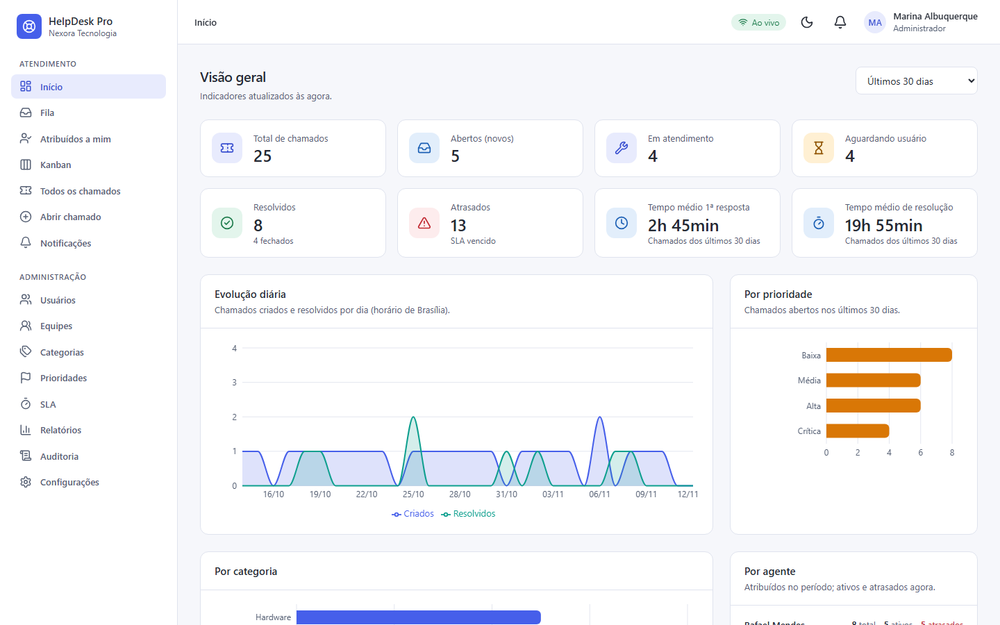
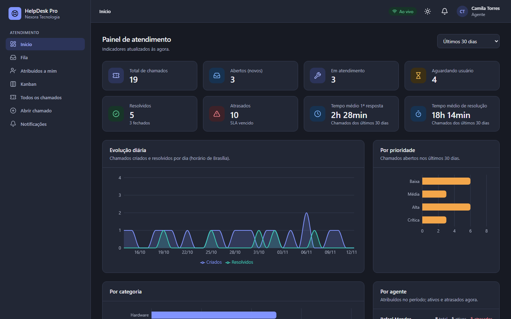
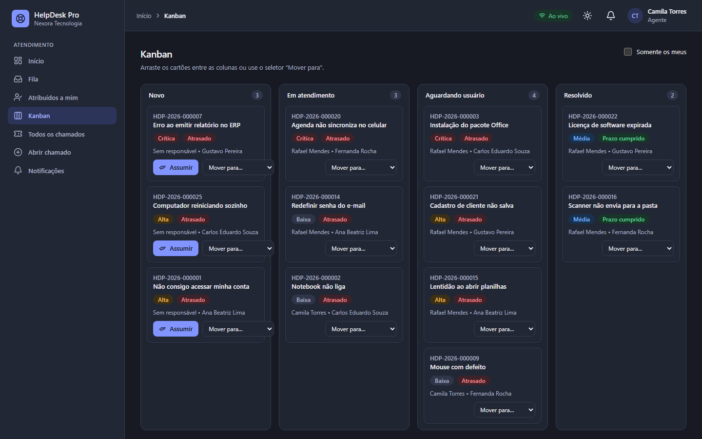
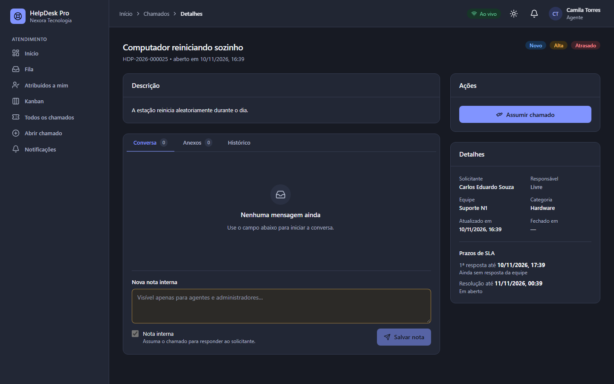
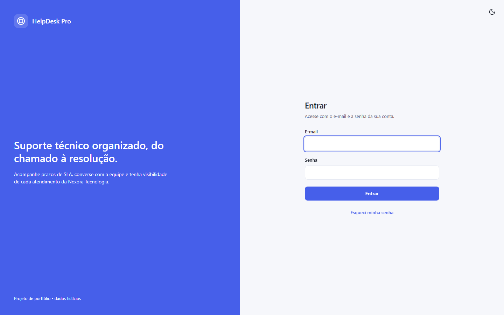
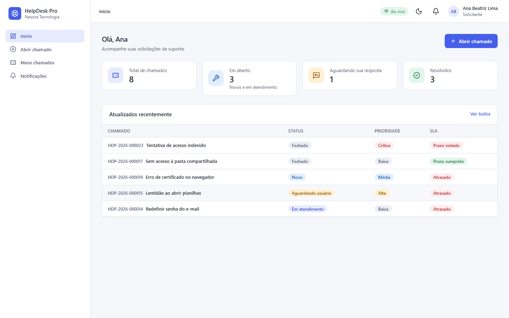
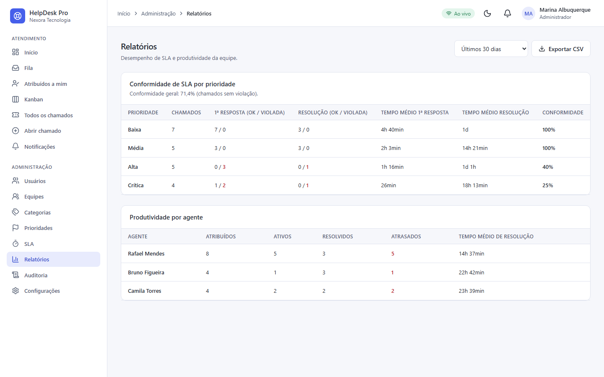
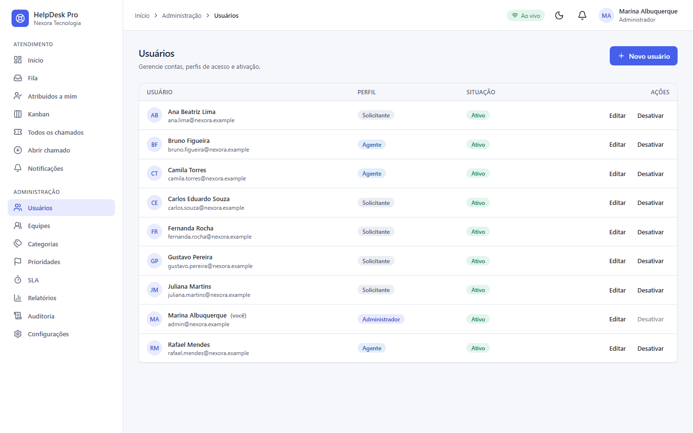
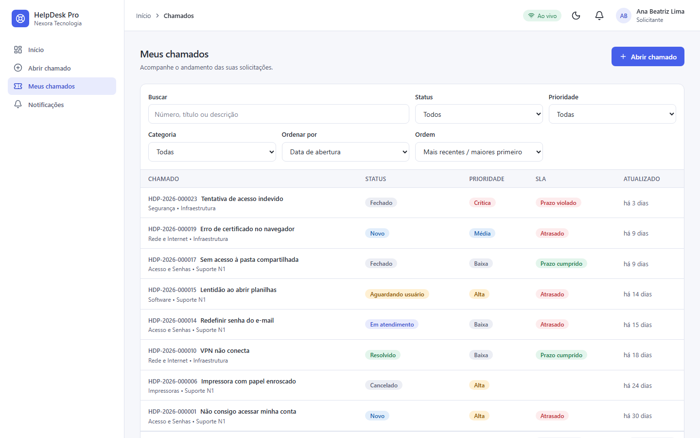
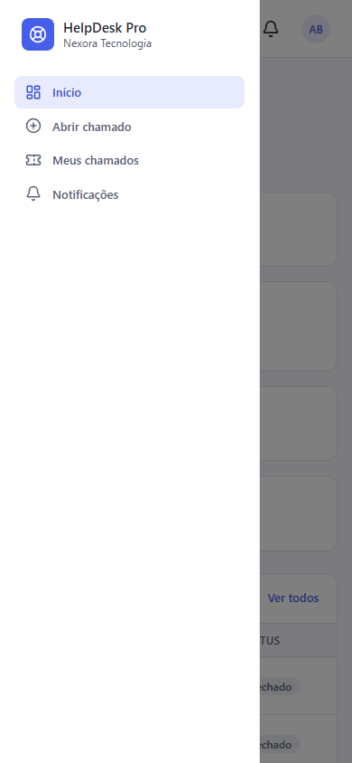

# HelpDesk Pro

Sistema de gerenciamento de chamados de suporte técnico para a empresa fictícia **Nexora Tecnologia**.
Projeto de portfólio Full Stack: API .NET 10 com PostgreSQL, autenticação com refresh token rotativo, permissões por papel,
SLA calculado no servidor, tempo real com SignalR e uma interface React em português, com tema claro e escuro.

> Todos os dados são fictícios. Execução 100% local, sem Docker e sem custos de infraestrutura.

| Administrador (claro) | Agente (escuro) |
|---|---|
|  |  |
| **Kanban (escuro)** | **Detalhe do chamado (escuro)** |
|  |  |

<details>
<summary>Mais telas</summary>

| Login | Início do solicitante |
|---|---|
|  |  |
| **Relatórios** | **Usuários** |
|  |  |
| **Meus chamados** | **Celular (menu em gaveta)** |
|  |  |

</details>

## Funcionalidades

**Solicitante** — abre chamados com categoria, prioridade e anexos; acompanha status e SLA; conversa com a equipe; reabre ou fecha o que foi resolvido; recebe notificações.

**Agente** — fila da equipe, chamados atribuídos, Kanban (arrastar ou "Mover para"), respostas públicas e **notas internas**, resolução, histórico completo.

**Administrador** — painel com indicadores reais, usuários, equipes e membros, categorias, prioridades, **SLA configurável**, relatórios (com exportação CSV), **auditoria** e configurações do sistema.

**Transversal**
- Máquina de estados validada no domínio (`NEW → IN_PROGRESS → WAITING_FOR_USER → RESOLVED → CLOSED`, mais `CANCELLED`), com histórico de cada transição.
- **SLA no backend**: prazos por prioridade, primeira resposta (só resposta pública de agente conta), aviso aos 80% do prazo, violação registrada uma vez pelo "Sistema", estado `no prazo / em risco / atrasado / cumprido / violado`.
- **Tempo real** (SignalR): novos chamados, mensagens, atribuições, mudanças de status e notificações chegam sem recarregar. Sem o canal, a aplicação segue por HTTP.
- **Segurança**: autorização no backend (nunca só no frontend), proteção IDOR, JWT curto + refresh rotativo em cookie HttpOnly, rate limiting, anexos validados pelo conteúdo real, cabeçalhos de segurança. Ver [docs/SECURITY.md](docs/SECURITY.md).
- **Acessibilidade e responsividade**: navegação por teclado, foco visível, contraste verificado nos dois temas, layout para desktop, tablet e celular.

## Tecnologias

| Camada | Stack (versões efetivamente usadas) |
|---|---|
| Backend | C# · .NET SDK 10.0.404 · ASP.NET Core Web API · EF Core 10.0.15 · Npgsql 10.0.3 · ASP.NET Core Identity · JWT Bearer 10.0.15 · SignalR · FluentValidation 12.2 · OpenAPI + Swagger UI 10.3 |
| Banco | PostgreSQL (desenvolvido e testado na 18; 16 e 17 também instaladas) |
| Frontend | React 19.3 · TypeScript 7 (strict) · Vite 8 · Tailwind CSS 4.3 · React Router 7 · TanStack Query 5 · React Hook Form 7 + Zod 4 · Recharts 3 · Radix UI (Dialog, Dropdown) · Lucide · @microsoft/signalr |
| Testes | xUnit · Vitest 5 + Testing Library · Playwright 1.65 + axe-core 4.14 |
| Ambiente de desenvolvimento | Windows 11 · PowerShell · Node 26 · npm 11 |

## Arquitetura (resumo)

```
React (Vite) ──HTTP/JSON + WebSocket──▶ Api ─▶ Application ─▶ Domain
                                          └──────▶ Infrastructure (EF Core · Identity · JWT · arquivos · SignalR publisher)
                                                         └─▶ PostgreSQL
```

Domain (regras e máquina de estados) não depende de nada; Application define contratos, DTOs e regras de acesso puras; Infrastructure implementa
persistência e serviços; Api só expõe HTTP, SignalR e segurança. Detalhes e decisões em [docs/ARCHITECTURE.md](docs/ARCHITECTURE.md).

## Requisitos

- Windows 10/11 com PowerShell 5.1+
- [.NET SDK 10](https://dotnet.microsoft.com/download) (`winget install Microsoft.DotNet.SDK.10`)
- Node.js 22+ (testado com 26) e npm
- PostgreSQL 16+ rodando localmente (usuário com permissão de criar bancos)
- Git

## Instalação e execução

```powershell
# 1) Dependências do frontend
cd frontend
npm install
cd ..

# 2) Banco, segredos e dados de demonstração (pede a senha do PostgreSQL e escolhe a porta)
.\scripts\setup-database.ps1 -Port 5432

# 3) Subir API (http://localhost:5080) e frontend (http://localhost:5173)
.\scripts\start-dev.ps1
```

O passo 2 cria o banco `helpdeskpro`, grava a connection string, uma chave JWT e uma **senha aleatória de demonstração** no
[User Secrets](https://learn.microsoft.com/aspnet/core/security/app-secrets) da API (fora do repositório), aplica as migrations e executa o seed.
Para ver a senha dos usuários de demonstração:

```powershell
cd backend\src\HelpDeskPro.Api
dotnet user-secrets list
```

> Qual porta do PostgreSQL? Veja o que está instalado em `C:\Program Files\PostgreSQL\<versão>\data\postgresql.conf` (`port =`).

### Usuários de demonstração (todos com a mesma senha de demonstração)

| Papel | E-mail | Observação |
|---|---|---|
| Administrador | `admin@nexora.example` | Marina Albuquerque |
| Agente | `rafael.mendes@nexora.example` | Suporte N1 + Infraestrutura |
| Agente | `camila.torres@nexora.example` | Suporte N1 |
| Agente | `bruno.figueira@nexora.example` | Infraestrutura |
| Solicitante | `ana.lima@nexora.example`, `carlos.souza@nexora.example`, `fernanda.rocha@…`, `gustavo.pereira@…`, `juliana.martins@…` | |

O seed é idempotente: 1 administrador, 3 agentes, 5 solicitantes, 2 equipes, 8 categorias, 4 prioridades e 25 chamados com mensagens e histórico coerentes.
Na primeira execução com a API ligada, o monitor de SLA registra as violações dos chamados antigos de demonstração (comportamento esperado).

## Configuração

Segredos ficam no User Secrets; o restante em variáveis de ambiente (`Chave__Subchave`). Principais opções:

| Chave | Padrão | Descrição |
|---|---|---|
| `ConnectionStrings:Default` | — (User Secrets) | PostgreSQL |
| `Jwt:Key` | — (User Secrets) | Chave de assinatura (≥ 32 caracteres) |
| `Seed:InitialPassword` | — (User Secrets) | Senha dos usuários do seed |
| `Cors:AllowedOrigins` | `http://localhost:5173` | Origens do frontend |
| `Sla:CheckIntervalSeconds` | `60` | Intervalo do monitor de SLA (`0` desliga) |
| `Attachments:StoragePath` | `%LOCALAPPDATA%\HelpDeskPro\attachments` | Pasta dos anexos (fora da pasta pública) |

Veja a tabela completa em [docs/DEVELOPMENT.md](docs/DEVELOPMENT.md). Exemplo de variáveis do frontend: [.env.example](.env.example).

## Testes

```powershell
.\scripts\test-all.ps1            # backend + frontend + E2E
.\scripts\test-all.ps1 -SkipE2E   # sem o Playwright
```

Última rodada completa: **401 testes, 0 falhas** — 282 de backend (111 unitários + 171 de integração com a API e o PostgreSQL reais),
74 de frontend e 45 E2E (fluxo completo com três usuários simultâneos, segurança, acessibilidade com axe nos dois temas, teclado e responsivo).
Detalhes e limites em [docs/TESTING.md](docs/TESTING.md).

## Estrutura do repositório

```
backend/    API .NET (src: Api · Application · Domain · Infrastructure | tests: UnitTests · IntegrationTests)
frontend/   React + Vite (src: app · components · features · layouts · pages · routes · lib · e2e)
docs/       Arquitetura, banco, API, segurança, testes, desenvolvimento e progresso
scripts/    setup-database · start-dev · test-all · e2e
```

## Documentação

[Arquitetura](docs/ARCHITECTURE.md) · [Banco de dados](docs/DATABASE.md) · [API](docs/API.md) · [Segurança](docs/SECURITY.md) · [Testes](docs/TESTING.md) · [Desenvolvimento](docs/DEVELOPMENT.md) · [Progresso](docs/IMPLEMENTATION_PROGRESS.md)

Com a API em Development: Swagger UI em `http://localhost:5080/swagger`.

## Limitações conhecidas

- **Escopo de portfólio**: uma única empresa; sem multi-tenancy, planos, cobrança ou integrações externas.
- **Recuperação de senha em modo demonstrativo**: não há envio de e-mail; em Development o token é exibido na tela. Em produção seria necessário um provedor de e-mail.
- **SLA em horas corridas**: sem calendário de feriados/expediente e sem pausa em "aguardando usuário".
- **Sem HTTPS local** (cookie sem `Secure`, sem HSTS) e **sem CSP no frontend** em desenvolvimento; ver riscos residuais em [docs/SECURITY.md](docs/SECURITY.md).
- Rate limiting em memória (instância única); anexos sem antivírus; sem 2FA.
- Monitor de SLA e dashboards calculam em memória/SQL simples: adequados à escala de demonstração, não a milhões de chamados.
- Testes E2E somente em Chromium; sem testes de carga.
- Alterar o prazo de uma prioridade vale para chamados criados depois (os existentes mantêm o prazo da abertura).
- Sem deploy nesta fase; o repositório ainda não possui licença definida.

## Autoria

Projeto desenvolvido como peça de portfólio por **Thiago-Tods**.
