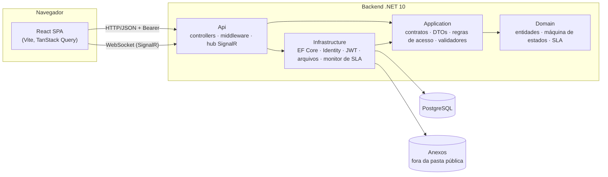
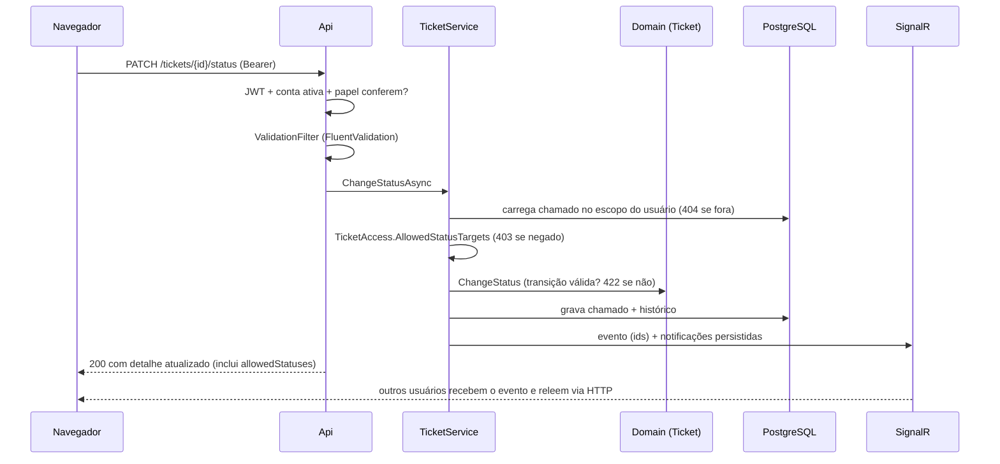

# Arquitetura

## Visão geral

Regra de dependência: **Domain não depende de ninguém**; Application depende só de Domain; Infrastructure implementa os contratos de Application;
Api compõe tudo. O frontend só conhece a API (DTOs em `frontend/src/types/api.ts`).

## Camadas do backend

| Projeto | Responsabilidade | Exemplos |
|---|---|---|
| `HelpDeskPro.Domain` | Regras de negócio puras | `Ticket` (transições, atribuição, mensagens, SLA), `TicketSla`, `Priority`, exceções de domínio |
| `HelpDeskPro.Application` | Casos de uso como contratos | Interfaces (`ITicketService`…), DTOs, `TicketAccess` (autorização pura), `FileInspector`, validadores FluentValidation |
| `HelpDeskPro.Infrastructure` | Detalhes técnicos | `AppDbContext`, serviços (`TicketService`, `AuthService`…), `TicketScope`, `SlaMonitor`, armazenamento local |
| `HelpDeskPro.Api` | Borda HTTP | Controllers finos, filtro de validação, tratamento de erros (Problem Details), JWT/CORS/rate limit, hub SignalR |

Sem repositórios genéricos nem CQRS/mediator: os serviços usam o `DbContext` diretamente. A abstração extra não pagaria o custo neste escopo.

## Decisões principais

**1. Regras no domínio, permissão no servidor.** A máquina de estados vive em `Ticket.ChangeStatus` (exceção de domínio → 422). Quem pode fazer o quê vem de
`TicketAccess` (função pura, testada) e é aplicado no serviço. O frontend recebe do servidor `allowedStatuses`, `canEdit`, `canAssignToMe` e `slaState`;
nenhuma regra de negócio é duplicada no React.

**2. Proteção IDOR por construção.** `TicketScope` define o que cada papel enxerga (admin: tudo; agente: equipes que integra + atribuídos; solicitante: os próprios).
Todo acesso a chamado, mensagem, anexo e histórico passa por ele; fora do escopo responde **404** (não revela existência). Notas internas são filtradas na consulta.

**3. Sessão.** JWT de 15 min (só em memória no navegador) + refresh token de 64 bytes aleatórios em cookie `HttpOnly; SameSite=Lax; Path=/api/v1/auth`.
No banco só existe o hash SHA-256. Rotação a cada uso; reutilizar um token já rotacionado derruba todas as sessões. A cada requisição o servidor confere que a conta
está ativa e que o papel do token coincide com o cadastro (desativar ou rebaixar vale na hora). Em desenvolvimento o Vite faz proxy da API, então o cookie é same-origin.

**4. SLA calculado no backend.** Prazos nascem da prioridade na abertura (`TicketSla`). O estado (`slaState`) é derivado no domínio (`GetSlaState`); avisos e violações são
registrados **uma vez** por `EvaluateSla`, chamado pelo `SlaMonitor` (worker a cada 60 s) ou no ato (resposta/resolução tardia). Violações entram no histórico com autor nulo ("Sistema").

**5. Tempo real sem vazar dados.** O hub coloca cada conexão em grupos derivados do token e do banco (`user:{id}`, `team:{id}`, `admins`); o cliente nunca escolhe grupos.
Os eventos carregam só ids; o cliente relê por HTTP, onde a autorização por recurso é aplicada. Notas internas nunca vão ao solicitante. Se o hub cair, o frontend passa a consultar periodicamente.

**6. Histórico confiável.** Entradas da mesma operação recebem instantes estritamente crescentes (1 µs) para ordem cronológica estável, sem depender da ordem de INSERT.

**7. Anexos.** Validação por extensão + tipo declarado + conteúdo real (assinatura, UTF-8, estrutura OpenXML); nome de armazenamento aleatório sem extensão; verificação de caminho;
download sempre como `attachment` com `nosniff`.

**8. Erros.** Problem Details (400 validação, 401, 403, 404, 422 regra de negócio, 429, 500 sem detalhes internos).

## Fluxo de uma requisição

## Frontend

| Pasta | Conteúdo |
|---|---|
| `app/` | Providers (tema, toast, React Query, autenticação), conexão em tempo real |
| `routes/` | Roteamento com carregamento sob demanda e guards por papel (403 sem redirecionar) |
| `layouts/` | Shell autenticado (sidebar, header, breadcrumbs, notificações) e moldura de login |
| `features/` | Hooks de dados por domínio (tickets, catálogo, insights) e componentes específicos |
| `pages/` | Uma página por rota (solicitante, agente, administração, sistema) |
| `components/ui/` | Kit próprio acessível (botão, campos, modal Radix, abas WAI-ARIA, tabela, toasts) |
| `lib/` | Cliente HTTP (renovação de sessão single-flight), formatação pt-BR / America/Sao_Paulo, validação |

Estado de servidor com TanStack Query (chaves por recurso, invalidação por eventos do SignalR); formulários com React Hook Form + Zod (validação de UX; a definitiva é a do servidor).
Tema por tokens CSS (`:root` e `[data-theme=dark]`) com contraste verificado por axe nos dois temas.

## Estratégia de testes

Pirâmide: muitos testes de domínio/serviço (rápidos), testes de integração com a **API real e PostgreSQL real** (sem mocks no backend), testes de tela com `fetch` simulado
(só em teste) e E2E com três navegadores simultâneos para o fluxo crítico, segurança, acessibilidade e responsividade. Uma **matriz de permissões** inventaria todos os endpoints
e falha se uma rota nova não for classificada. Ver [TESTING.md](TESTING.md).

## Trade-offs e evolução

| Escolha | Custo | Caminho de evolução |
|---|---|---|
| Serviços usam `DbContext` direto | Acoplamento de Application→EF nos serviços da Infrastructure | Extrair repositórios/queries se houver mais de uma fonte de dados |
| Monitor de SLA avalia chamados ativos em memória | Não escala a milhões de linhas | Consulta por "próximo vencimento" indexada ou fila de jobs |
| Validação do token consulta o banco a cada requisição | 1 consulta extra por chamada | Cache curto (segundos) invalidado na desativação |
| Rate limit em memória | Não compartilha entre instâncias | Armazenamento distribuído |
| Dashboard computa agregações por requisição | Custo cresce com o volume | Tabelas de agregação/materialized views |
| Frontend em SPA servida pelo Vite | Sem CSP/headers próprios | Hospedagem estática com CSP e HTTPS |
