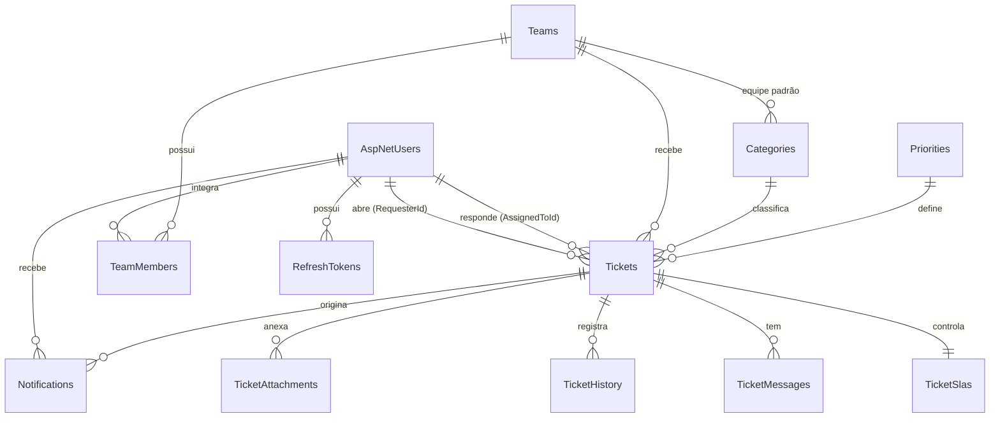

# Banco de dados

PostgreSQL via EF Core 10 + Npgsql. IDs UUID, timestamps UTC (`timestamptz`), chaves estrangeiras com `Restrict` (sem exclusão em cascata de dados históricos).

## Modelo



## Tabelas

| Tabela | Observações |
|---|---|
| `AspNetUsers` / `AspNetRoles` / `AspNetUserRoles` (Identity) | `FullName`, `IsActive`, `CreatedAt`. Papéis: ADMIN, AGENT, REQUESTER |
| `Teams`, `TeamMembers` | Equipes e vínculos (só agentes). `IsActive` para desativar |
| `Categories` | `DefaultTeamId`: equipe que recebe os chamados da categoria |
| `Priorities` | `Level` único, `FirstResponseMinutes` e `ResolutionMinutes` com *check constraint* (resolução ≥ primeira resposta) |
| `Tickets` | `TicketNumber` legível e único (`HDP-AAAA-NNNNNN`), `Status` (texto), datas de resposta/resolução/fechamento |
| `TicketSlas` | Prazos (`FirstResponseDueAt`, `ResolutionDueAt`), `FirstRespondedAt`, `BreachedAt`, violações e avisos por tipo (`FirstResponseBreachedAt`, `ResolutionBreachedAt`, `*WarnedAt`) |
| `TicketMessages` | `IsInternal` (notas internas só para a equipe) |
| `TicketHistory` | Ação, valores antigo/novo, `ActorId` **nulo = Sistema**, `Sequence` (identidade) |
| `TicketAttachments` | Nome original (sanitizado), **nome de armazenamento aleatório**, tipo detectado, tamanho |
| `Notifications` | Tipo, mensagem, lida/não lida; índice por (usuário, lida, data) |
| `RefreshTokens` | **Apenas o hash** SHA-256; `RevokedAt`, `ReplacedByTokenId` (rotação e detecção de reutilização) |

## Regras e decisões
- **Número do chamado** gerado no backend pela sequence `ticket_number_seq` (inicia em 1000); o seed usa 1..25.
- **Exclusão lógica** via `IsActive` (usuários, equipes, categorias, prioridades). Chamados nunca são apagados: terminam em `CANCELLED`.
- **Ids** (`Guid`) são gerados pelo domínio e configurados como `ValueGeneratedNever`, para o EF tratar filhos novos de entidades rastreadas como inserções.
- **Índices:** número do chamado (único), status, solicitante, responsável, equipe, data de criação, prazos de SLA, (chamado, data) em mensagens e histórico, hash do refresh token (único).
- **Mudar o prazo de uma prioridade** não recalcula chamados existentes (cada `TicketSlas` guarda os prazos da abertura).
- **SLA:** horas corridas; o estado (`slaState`) é derivado no domínio, não armazenado.

## Migrations
`backend/src/HelpDeskPro.Infrastructure/Persistence/Migrations`:

| Migration | O quê |
|---|---|
| `InitialCreate` | Esquema inicial |
| `AddCategoryDefaultTeam` | Equipe padrão por categoria |
| `AddHistorySequence` | Coluna de ordem estável no histórico |
| `SlaTracking` | Campos de violação/aviso por tipo, `ActorId` anulável (com *backfill* dos dados existentes) |

```powershell
# criar
dotnet ef migrations add <Nome> --project backend\src\HelpDeskPro.Infrastructure --startup-project backend\src\HelpDeskPro.Api --output-dir Persistence\Migrations
# aplicar (usa o User Secrets)
cd backend\src\HelpDeskPro.Api; $env:ASPNETCORE_ENVIRONMENT='Development'; dotnet run --no-launch-profile -- migrate
```

## Dados de demonstração
`dotnet run --no-launch-profile -- seed` (ou `scripts\setup-database.ps1`) é **idempotente**: cria papéis, 4 prioridades (Baixa 8h/72h, Média 4h/48h, Alta 1h/8h, Crítica 15min/4h),
8 categorias, 2 equipes (Suporte N1, Infraestrutura), 9 usuários e 25 chamados em todos os status, com mensagens e histórico gerados pelas próprias regras do domínio.
Exige `Seed:InitialPassword` (User Secrets ou variável de ambiente); nenhuma senha é versionada.
